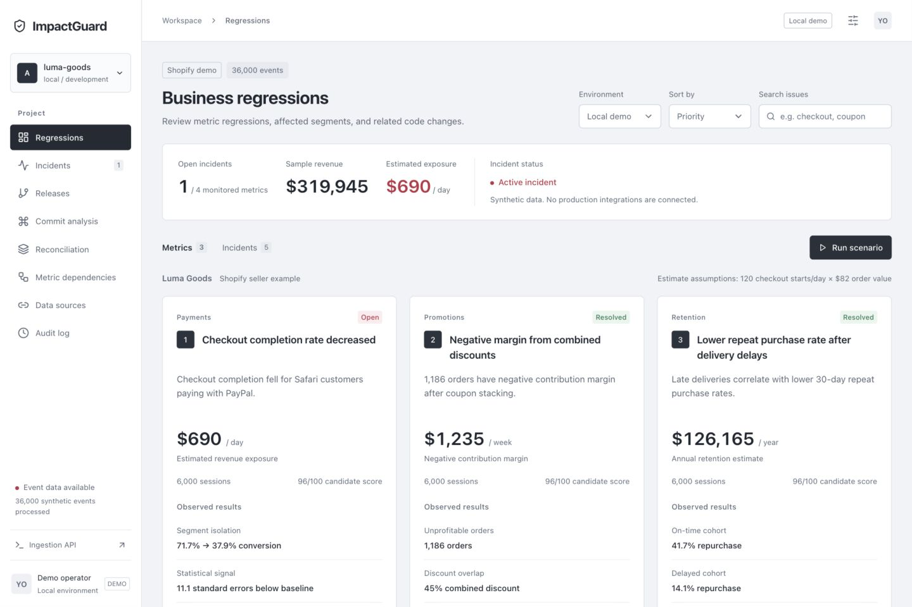

# ImpactGuard

[Public demo](https://impactguard-182850660018.us-central1.run.app/) · [Production access and cost controls](docs/production.md)



[Product document (PDF)](output/pdf/ImpactGuard-product-document.pdf) · [Connections and AI setup](docs/connections-and-ai.md)

Business regression investigations for developers. Connect a release to a customer outcome, inspect suspect commits, calculate financial exposure, and record a review decision.

## Run locally

Requires Node 22.12+ and Python 3.10+. No cloud credentials or Python dependencies are needed for the default demo.

```bash
npm ci
npm run build
python3 backend/server.py
```

Open http://127.0.0.1:8080. Or use `./scripts/start-local.sh`.

Development: run the Python server and `npm run dev` in separate terminals. Vite proxies `/api` to port 8080. The production build is served by Python from `dist/`.

## Demo

1. Run **Checkout regression**. The generator persists 6,000 sessions for the current simulated hour and compares them with 30,000 historical sessions across 30 days.
2. Open the issue. Inspect affected segments, statistical evidence, the suspect commit, and its diff.
3. Click **Investigate** for a deterministic evidence explanation. The provider label is explicit. Optional Vertex AI support requires explicit configuration below.
4. Select **Mark resolved**, **Ignore**, or **Not an issue**. These actions change review state only. Source events, bank statuses, and ledger postings remain unchanged. Select **Reopen** to investigate again.
5. Run **Promotion stacking** or **Delivery delays** to evaluate other business regressions. Resolve the active incident before launching the next one. Historical incidents remain accessible.
6. Export a JSON incident report or review the persistent activity log.

The written PDF contains the current demo guide, seller and banking examples, competitor comparison, and AI capability matrix. The older video and slides show the former remediation simulation and are retained as historical assets.

## What works

- Responsive React developer dashboard, issue search and sorting, release history, impact graph, activity log, report exports
- Real SQLite persistence, repeatable synthetic event generation and threshold-based detection
- Red regression states and green healthy/reviewed states
- Banking settlement reconciliation with integer-cent postings and and duplicate/missing credit checks
- Segment isolation, two-proportion standard-error comparison, negative-margin detection, mature retention cohort comparison
- Deterministic financial exposure with units and assumptions displayed in each investigation
- Heuristic commit ranking from timestamps, filenames and diff content, plus native diff inspection
- Read-only GitHub import, up to 10 repositories per project, with sensitive-file filtering and bounded redacted patches
- Idempotent ingestion endpoint with stable event IDs
- Manual review states without code or ledger changes
- Shopify and GA4 read-only connectors, generated samples, and separate source analysis
- Optional Vertex AI classification and investigation with configurable checks, caching, and token limits
- Docker image and BigQuery migration SQL prepared for a later cloud phase

## Honest boundaries

The traffic, demo releases, diff fixtures, and customer outcomes are synthetic. The default investigator uses evidence rules, not an LLM. External events are stored separately from demo analytics. GitHub-imported commits are not falsely attached to fictional demo incidents. The real-commit ranking API requires a supplied anomaly onset and service scenario. Production attribution also requires mapping deployed versions to commit SHAs.

Commerce financial numbers are scenario projections. The banking amount is the observed discrepancy in synthetic ledger records. Seller projections assume 120 checkout starts/day and an $82 order value. They are not actual losses or proven savings. Contribution margin uses an assumed 64% product cost, with additive 45% coupon discounts. Retention uses synthetic mature 30-day outcomes and scales the delayed-cohort share to 120 seller checkout starts/day, 30 days/month, and twelve months/year. Confidence scores rank hypotheses and are not causal probabilities. The checkout test assumes independent Bernoulli outcomes, and production baselines need time-of-day controls, multiplicity correction, seasonality and minimum-volume policies.

The chart is a two-hour replay: a healthy baseline sample followed by the current scenario sample. The timeline uses synthetic event chronology in UTC. It is explicitly labeled. This app does not claim to be collecting continuous live production telemetry.

## GitHub integration

Use **Codebases**, enter an `owner/repository`, and click **Connect codebase**. Public repositories need no token. For a private repository, start the server with an explicitly selected personal fine-grained read-only token in `IMPACTGUARD_GITHUB_TOKEN`. Do not put a token into the UI or a tracked file. The adapter never reads ambient `gh` credentials. No repository has been connected by this build.

`POST /api/github/rank` accepts `{"scenario":"checkout","anomaly_start":"2026-10-10T14:09:00Z"}` after a repository sync. Scoring weights: timing 30%, service-path overlap 30%, diff terms 25%, segment terms 15%. A hypothesis also needs eligibility within the preceding 60 minutes. Diff keyword matching is a starting point, not a semantic code analysis model.

## Vertex AI and collection

See [connections and AI setup](docs/connections-and-ai.md). Vertex uses explicit `IMPACTGUARD_VERTEX_PROJECT`, `IMPACTGUARD_VERTEX_CREDENTIALS`, and `GEMINI_MODEL`. Ambient Google credentials are not used. AI runs only on operator requests; deterministic measurement and ledger validation remain. Integrations provides generated Shopify and GA4 samples, including traffic, security-signal, and data-quality cases.

## API

| Endpoint                         | Purpose                                     |
| -------------------------------- | ------------------------------------------- |
| GET `/api/health`                | Local readiness                             |
| GET `/api/dashboard`             | Metrics, findings, series, releases, audit  |
| POST `/api/scenarios`            | `{scenario: checkout/promotion/delivery/banking}`   |
| POST `/api/actions`              | `{action: resolve/ignore/not_issue/reopen/assign, finding_id?: id}` |
| POST `/api/investigate`          | `{finding_id?: id}` evidence explanation    |
| GET `/api/export?finding_id=...` | JSON incident and audit report              |
| POST `/api/reset`                | Reset synthetic demo data                   |
| POST `/api/events`               | Store an external unified event             |
| GET `/api/github`                | Project repositories and integration status                      |
| POST `/api/github/connect`       | Read-only GitHub sync                       |
| POST `/api/github/rank`          | Rank imported commits against an onset      |

| POST `/api/integrations/config` | Non-secret collection settings and AI checks |
| POST `/api/integrations/collect` | Read-only source collection or generated samples |
| POST `/api/integrations/analyze` | Aggregate validation and optional AI classification |

## Verification

```bash
npm run build
npm test
```

Tests cover regression isolation, dollar arithmetic, manual review without evidence changes, coupon loss, retention cohorts, idempotency, invalid event data, scenario guards, ledger preservation, duplicate and missing postings, commit scoring, onset eligibility, repo validation and mocked GitHub diff sync. Browser QA covers the issue dashboard, investigation, response and commit diff screens.

## Local architecture

React / Vite → Python HTTP API → SQLite events → metric detector → commit correlation → evidence investigator → persisted findings / audit.

Keep this as one deployable unit until data throughput or independent scaling justifies splitting services. The demo server binds to loopback by default. Cloud-hosted operation needs an authenticated production service, durable state, request validation, rate limits, audit ownership and background processing. The Docker demo uses ephemeral local state and is not a multi-instance production datastore.

## Personal GCP deployment

See [the deployment and cost guide](docs/deploy-personal-gcp.md). Start with an isolated personal gcloud configuration and a private, scale-to-zero Cloud Run demo. Expect roughly $0–$5/month for light use, subject to actual usage and free-tier eligibility. SQLite is ephemeral on Cloud Run. No deployment has been executed.

## Rebuilding the presentation assets

The current written document is generated with `scripts/create-product-document.py` and ReportLab. The older deck and video are historical assets; their remediation demonstration is no longer current. `scripts/create-demo-video.py` uses the captured screenshots in `docs/demo-assets/`, macOS `say`, and FFmpeg. The deck authoring script uses the Codex bundled presentation runtime and requires `RUNTIME_NODE_MODULES`, `PRESENTATION_SKILL_DIR`, and `RUNTIME_PYTHON`. These authoring tools are not needed to run the web app.

An optional GitHub Actions configuration is included at `docs/github-ci-template.yml`. To enable it, copy it to `.github/workflows/ci.yml` using a credential authorized to manage workflows. The same build and tests run locally with `npm run build` and `npm test`.
